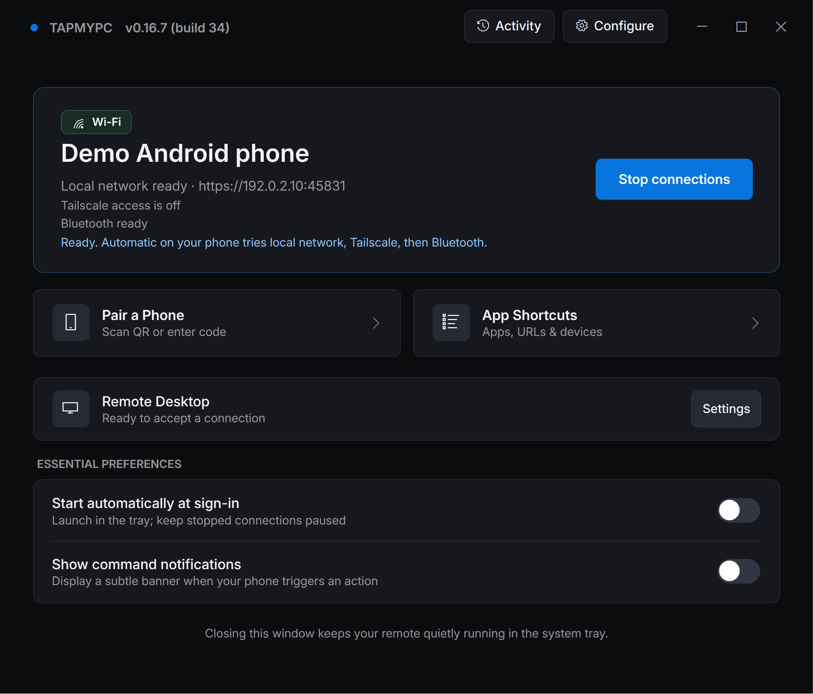
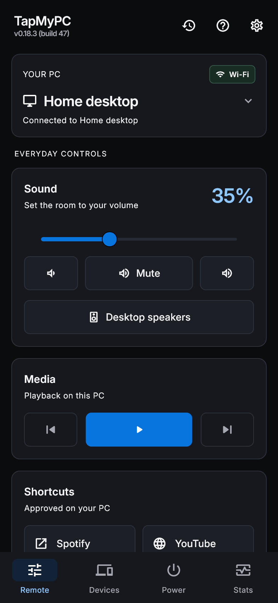
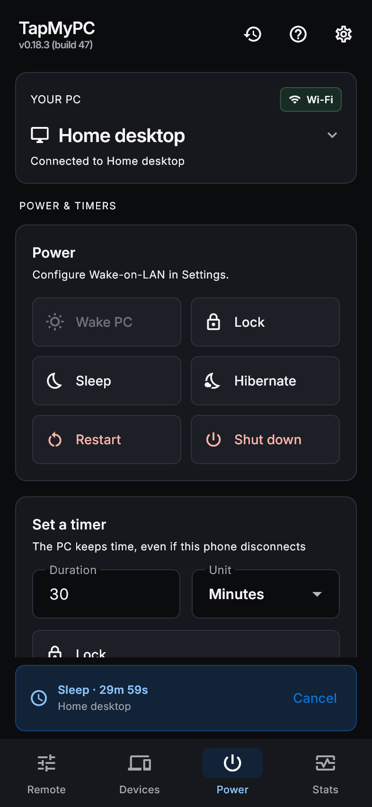

# TapMyPC

*Your PC, a tap away.*

TapMyPC is a personal remote for a Windows PC. Use the Flutter Android app or the browser remote to manage audio, media, displays, shortcuts, and power. The C# desktop host runs in the Windows tray.

| Component | Current development version |
| --- | --- |
| Windows desktop and API | **0.16.7 (build 34)** |
| Android | **0.18.3 (build 47)** |

Both apps include **About TapMyPC** with app and build information, setup help, third-party notices, and a link to the GitHub repository. Open it from **Settings** on Android or the **Configure** drawer on Windows.

## Screenshots

**Windows dashboard** · Pair a phone, see connection status, and manage Remote Desktop.



**Android** · Control sound and media, launch shortcuts, and set PC power timers.

 

Screenshots use demo devices and connection details.

## Get started

1. [Build and run the Windows host](docs/setup.md#build-and-launch), or [apply a staged desktop update](docs/setup.md#apply-a-staged-update).
2. [Build the Android app](mobile/README.md#development). Put your phone and PC on the same trusted network, open TapMyPC on the PC, and pair from the phone with **Add PC → Scan PC QR**. The [browser remote](docs/setup.md#connect-a-phone) uses the displayed HTTPS address and a one-time code.
3. Leave Android on **Automatic** to prefer the local connection and try other saved routes when needed. See the [connection guide](docs/tailscale.md#connection-choices).

## Connect and wake

- On the **local network**, use Android or a browser to control your PC.
- To use **Tailscale**, enable **Allow access through Tailscale** under **Configure → Remote access** on Windows. Android can then control the awake PC from another network or cellular while local access stays available. [Tailscale setup](docs/tailscale.md)
- After pairing over Wi-Fi, select **Bluetooth only** in Android connection settings. TapMyPC waits for system pairing before switching. Confirm the matching code on the phone and PC if prompted. [Bluetooth setup](docs/bluetooth.md)
- To use **Wake-on-LAN**, join the PC’s local Wi‑Fi, then select **Power → Wake PC** once the selected PC shows **Offline**. Set or review the adapter details in **Settings → Wake-on-LAN**. The PC must support wake in its current power state. [Wake-on-LAN setup](docs/setup.md#android-wake-on-lan)

Android saves profiles separately for each PC. Reconnection verifies the saved PC identity before sending credentials. The Windows host owns power timers.

On supported Android launchers, long-press TapMyPC for the selected PC’s Wake and Remote Desktop shortcuts. Add a TapMyPC Controls widget to the home screen to choose a paired PC and access Wake PC, Desktop, and Refresh. [Home-screen controls](mobile/README.md#home-screen-controls)

Windows and Android use the theme text color for connection badge icons and labels, including when offline. Badge backgrounds and outlines identify Wi-Fi, Tailscale, and Bluetooth. On Windows, active phone names use the theme text color and the outer card border uses the accent. [Connection status](docs/setup.md#phone-names-and-connection-feedback)

Android lets you set power timers in seconds or minutes. With an updated Windows host, Android sends Lock, Sleep, and Hibernate immediately after confirmation. [Power actions and timers](docs/setup.md#timers-and-controls)

On Android, open **Stats** to see hardware readings. On the PC, run PC Stats Tray 0.7.1 or newer and select **Show Stats → Local apps**. Check the collector status in TapMyPC Desktop under **Configure → Hardware monitoring**. [Hardware monitoring](docs/monitoring-integration.md)

The experimental Android **Power → Open desktop** viewer shows and controls the Windows console over Wi-Fi or Tailscale. TapMyPC for Windows downloads the latest stable UltraVNC installer when needed, shows progress during setup, and manages the local capture service and viewer password. The dashboard offers Remote Desktop setup and identifies the connected viewer once the service is configured and the phone reports successful VNC sign-in. Android offers automatic fullscreen in landscape, a toolbar with keyboard, rotation and PC audio, and Fit or pannable Fill. Open the viewer options for presets, saved custom stream settings, live stream diagnostics, and a reset to the default settings. The viewer attempts to reconnect after an unexpected interruption. The viewer automatically requests a full frame after connection and when Windows changes desktops. With both apps updated, a locally authorized phone can play audio from the default Windows output during a viewer session and remember its audio choice for that PC. [Remote Desktop setup](docs/setup.md#remote-desktop-preview)

## Development

The Windows host uses the .NET 10 SDK version in `global.json`. Run from the repository root.

```powershell
dotnet build TapMyPC.sln -c Release -m:1
dotnet test TapMyPC.sln -c Release -m:1
dotnet run --project src/TapMyPC.Desktop -c Release
```

See the [Android build guide](mobile/README.md#development), the [simulator](docs/setup.md#simulator), and the [documentation index](docs/README.md) for setup, architecture, and the API contract.

## License

TapMyPC is available under the [MIT License](LICENSE). Bundled components retain their [third-party licenses and notices](THIRD_PARTY_NOTICES.md).
